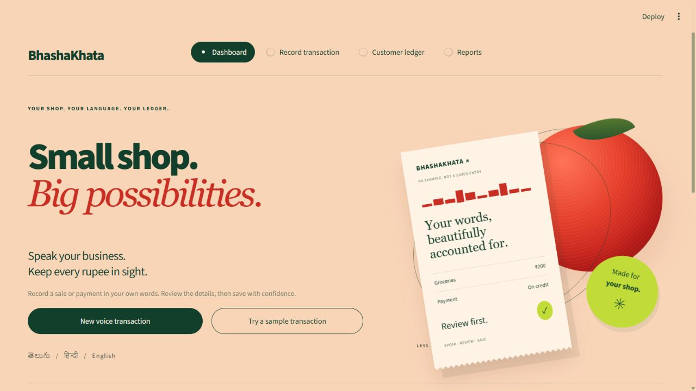
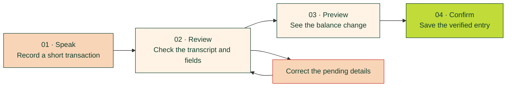

<div align="center">

# BhashaKhata

### Small shop. Big possibilities.

**Speak Your Business. Track Every Rupee.**

An Indian-language voice ledger that turns everyday shop conversations<br>
into transactions you review, understand, and confirm.


**తెలుగు · हिन्दी · English**

[Read the pitch](SOLUTION_PITCH.md) · [Try it locally](#try-it-locally) · [Demo walkthrough](#a-minute-in-the-life-of-a-shopkeeper) · [Technical details](#under-the-hood)

</div>



<p align="center"><sub>A shop-first homepage. The decorative receipt is an example, not a saved transaction.</sub></p>

---

## A ledger that starts with your voice

A busy shopkeeper should not have to pause every customer conversation to navigate an accounting form. BhashaKhata starts with a short spoken transaction, keeps the original words, and helps the shopkeeper turn them into a clear financial record.

> **“Ramesh ko 2 kilo rice diya, 130 rupees udhaar mein add karo.”**
>
> Speak naturally. Check the proposed details. Confirm what belongs in the ledger.

Gnani Prisma provides the speech recognition. A conservative parser suggests fields for supported transaction phrases; unfamiliar or uncertain details stay open for manual review.

## The idea: verified voice transactions

**Your voice starts the entry. Your confirmation saves it.**



A supported correction such as **“No, amount 130 ka badle 150 karo”** changes the pending amount. The original transcript and correction history remain available, and the revised entry still needs confirmation.

## Built around the shop counter

| What you need | What BhashaKhata does |
| :--- | :--- |
| **Speak in your language** | Gnani transcription with Indian-language and mixed-language input options; English, Hindi, and Telugu interface labels. |
| **Know who owes what** | Separate customer credit, repayments, cash sales, shop borrowing, and money lent. |
| **Understand before saving** | Editable fields, explicit account selection, and a preview of the exact balance effect. |
| **Correct mistakes clearly** | Pending-amount corrections and linked reversal entries for saved transactions. |
| **Keep dependable records** | SQLite persistence, integer-paise money storage, and durable duplicate-save protection. |
| **See the bigger picture** | Balance cards, customer histories, date-filtered reports, and CSV export. |

## A minute in the life of a shopkeeper

Use a **fictional account** for this walkthrough:

1. Open **Try a sample transaction** to review a fictional ₹200 credit sale without a speech API call.
2. Check the original text, choose the account, and verify the amount and transaction type.
3. Open the balance preview. Nothing has been saved yet.
4. Tick the verification checkbox and confirm **only if you want the practice entry stored in your local ledger**. Otherwise, cancel.
5. Open **Customer ledger** to inspect saved history, or **Reports** to export records.

For a microphone demonstration and correction sequence, follow the [hackathon walkthrough](HACKATHON.md). Manual entry is also available for offline practice.

## Try it locally

### 1. Install

Run these commands from the project folder. Python 3.12 was used for verification.

```powershell
python -m venv .venv
.\.venv\Scripts\python.exe -m pip install -r requirements.txt
```

### 2. Configure speech recognition

Create `.streamlit/secrets.toml` and add your key locally. If that file already exists, preserve its settings.

```toml
GNANI_API_KEY = "your-gnani-key"

# Optional: Google AI Studio translation for display
GEMINI_API_KEY = "your-gemini-key"
```

No credentials are needed to explore the fictional sample or manual entry. A valid Gnani key is required for microphone transcription. Keep actual keys out of Git and screenshots.

<details>
<summary><strong>Optional translation and local settings</strong></summary>

Gemini takes priority when configured. Azure Translator is an alternative through `AZURE_TRANSLATOR_KEY` and `AZURE_TRANSLATOR_REGION`. Translation helps display the transcript; it does not decide amounts or accounting direction. Manual review remains available without a translation provider.

See [secrets.example.toml](secrets.example.toml) for optional settings such as a local app password and database path. The app runs in local mode; hosted mode is blocked until durable hosted storage and per-shop access controls are implemented.

</details>

### 3. Start the app

```powershell
.\.venv\Scripts\python.exe -m streamlit run app.py
```

Open the local URL printed in the terminal. Choose **New voice transaction**, select the input language, and record one transaction at a time.

## Under the hood

```text
Microphone → Gnani Prisma → Original transcript
                                   ↓
                         Supported-command parser
                                   ↓
                         Editable review + preview
                                   ↓
                         Explicit user confirmation
                                   ↓
                         SQLite ledger → Reports
```

| Layer | Implementation |
| :--- | :--- |
| Interface | Streamlit, custom CSS, responsive layout, reduced-motion support |
| Speech | Gnani REST adapter in `speech.py` |
| Field suggestions | Conservative multilingual parsing in `extraction.py` |
| Ledger | Accounts, integer paise, deduplication, and linked reversals in `ledger.py` |
| Language support | Interface labels in `i18n.py`; optional display translation in `translation.py` |
| Verification | Pytest and Streamlit AppTest with fictional data and mocked APIs |

### Run the checks

```powershell
.\.venv\Scripts\python.exe -m pip install -r requirements-dev.txt
.\.venv\Scripts\python.exe -m pytest -q
```

Tests cover balance direction, confirmation, corrections, duplicate saves, persistence, reversals, API failures, and UI workflows. Automated speech tests use mocks and do not consume Gnani credits. See [project status](PROJECT_STATUS.md) for recorded verification results.

## Where the project stands

**Working local prototype:** speech integration, supported-command extraction, reviewed transactions, persistent customer accounts, and reports.

**Still to validate or build:** measured real-world speech accuracy, broader phrase coverage, durable hosted storage, and per-shop cloud authentication. This is a customer ledger, not a complete double-entry accounting system.

Original transcripts and financial records stay in the local ledger. Recorded audio is sent to Gnani for transcription; configured translation providers receive transcript text during the translation step in review. Credentials and local database files are excluded from Git.

## Explore the project

- [One-page solution pitch](SOLUTION_PITCH.md) — the problem, approach, and intended impact.
- [Hackathon walkthrough](HACKATHON.md) — a concise demonstration sequence.
- [Speech evaluation](SPEECH_EVALUATION.md) — recording prompts and evaluation procedure.
- [Deployment checklist](DEPLOYMENT.md) — requirements before hosting real records.
- [Project status](PROJECT_STATUS.md) — implementation and validation history.

---

<div align="center">

**Less paperwork. More possibility.**

Built for the words spoken across a shop counter—and the trust behind every rupee.

</div>
